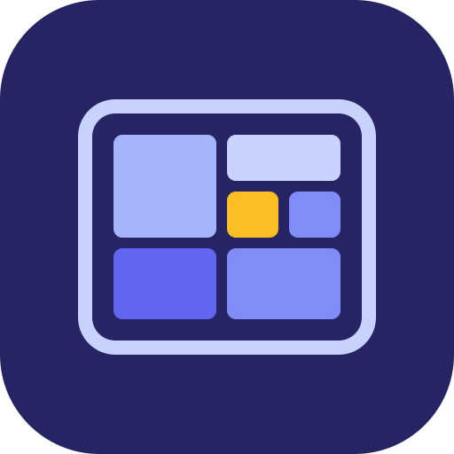
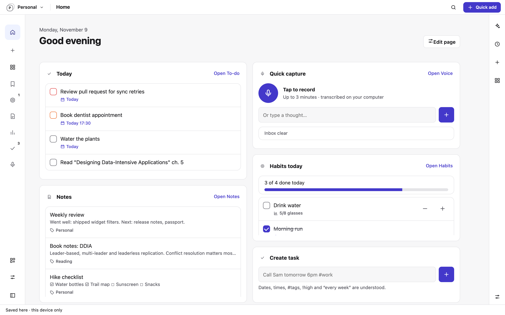
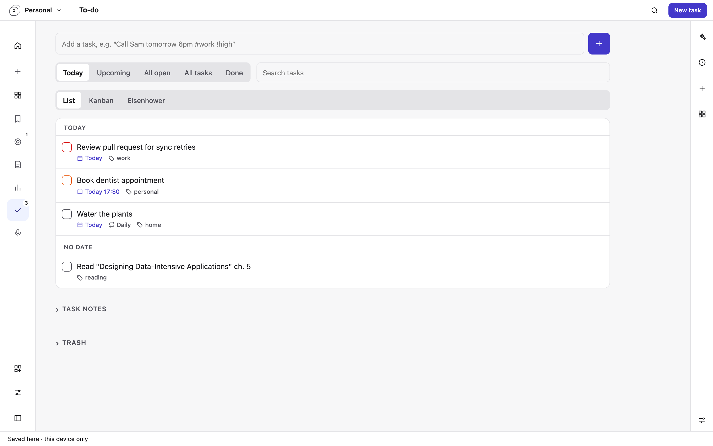
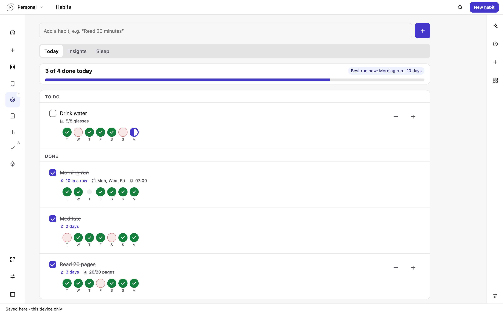
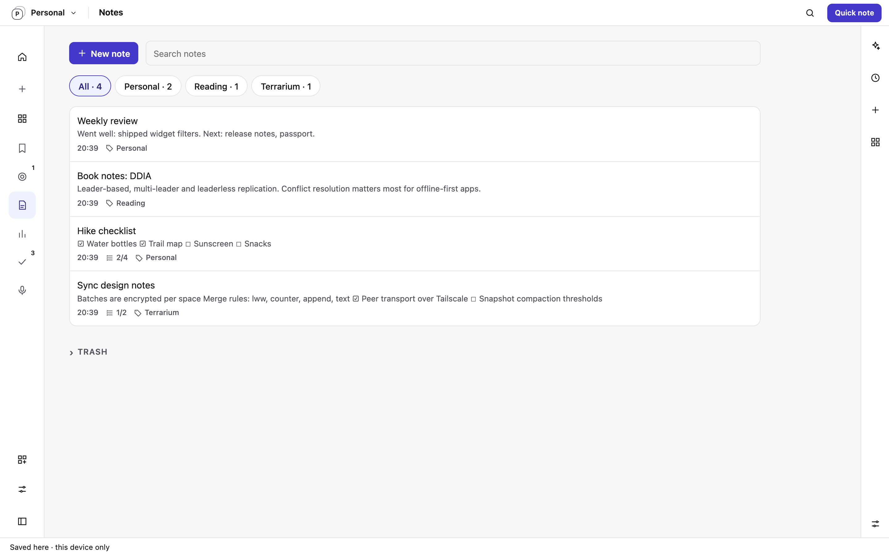
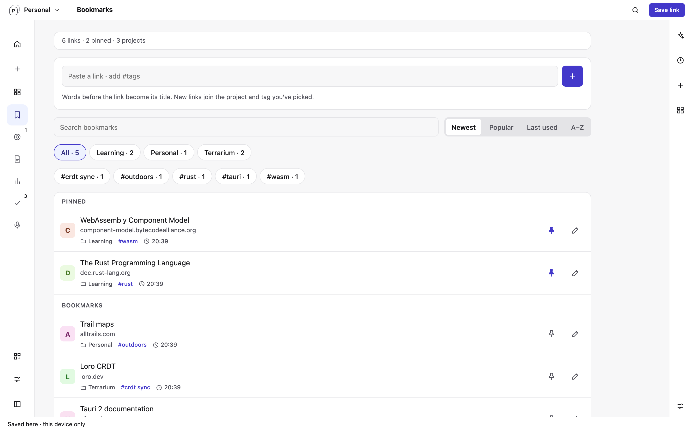

<p align="center">
  
</p>

<h1 align="center">Terrarium</h1>

<p align="center">
  An extensible, local-first app host for macOS and Android. Every feature is a sandboxed WebAssembly plugin.
</p>

<p align="center">
  <a href="https://github.com/RAHUL445/terrarium/actions/workflows/checks.yml"></a>
  <a href="LICENSE"></a>
  
</p>

Terrarium is a host, not an app with a fixed feature set. It provides what
every personal-data app needs: storage, end-to-end encrypted sync between your
devices, a sandbox, a UI shell, a scheduler and AI access. Features arrive as
plugins that you install or write yourself. Every device keeps a full copy
of its data and works offline, with no project server.

> **Status:** experimental source preview. It is not a production release and
> has known security gaps; read [SECURITY.md](SECURITY.md) before using it with
> real data.

<picture>
  <source media="(prefers-color-scheme: dark)" srcset="docs/screenshots/home-dark.png">
  
</picture>

<table>
  <tr>
    <td></td>
    <td></td>
  </tr>
  <tr>
    <td></td>
    <td></td>
  </tr>
</table>

<sub>Terrarium running the <a href="#recommended-plugins">recommended plugins</a>. Screenshots use synthetic demo data.</sub>

## What the host provides

Plugins get these for free, so a plugin is mostly a schema, a few operations
and some templates.

- **Sandboxed plugins.** Each plugin is a WebAssembly component with its own
  SQLite database, capability-gated host APIs and per-call fuel, time and
  memory limits. Packages are signed; installs and permission increases need
  your consent. Plugin UI is declarative templates, so plugins cannot run code
  in the app shell.
- **Sync for every plugin.** Plugins declare per-column merge rules
  (last-writer-wins, counters, append-only, Loro text CRDT) and the host syncs
  their data. Batches are encrypted and signed, and travel directly between
  devices over Tailscale or through your own Google Drive app folder. Deletes
  go to trash by default.
- **One UI for desktop and phone.** A shared web shell renders plugin
  templates, custom pages with a widget grid where plugins share one screen,
  a search palette and themes.
- **Spaces.** Keep Personal, Work and other spaces apart while sharing one
  plugin list and pairing.
- **Scheduler and AI.** Plugins can schedule jobs and reminders and generate
  text through any OpenAI-compatible provider you configure, local or remote.
- **Developer CLI.** `terra` scaffolds, builds, checks, hot-reloads, signs and
  previews plugins in a browser.

See [architecture](docs/architecture.md) for how the pieces fit together and
[writing a plugin](docs/plugin-authoring.md) to build your own.

## Recommended plugins

The recommended plugins live in their own repository,
[terrarium-plugins](https://github.com/RAHUL445/terrarium-plugins), and are
built against the same public SDK as any third-party plugin. The desktop and
Android builds ship them as a digest-pinned bundle, and you can install more
plugins as signed `.terrapkg` packages from a file or a Git repository.

| Plugin | Features |
| --- | --- |
| **To-do** | Tasks with due dates, reminders, priorities, repeats and steps; list, board and matrix layouts |
| **Notes** | Markdown notes in projects with checklists and autosave; edits on different devices merge |
| **Habits** | Scheduled habits with check-ins, streaks, reminders and sleep logs |
| **Bookmarks** | Links with projects, tags and notes; pin the ones you use most |
| **Voice** | Record or type quick captures, transcribed locally, then send them to To-do or Notes |
| **Reports** | AI-written reviews of your tasks, habits and notes, on demand or on a schedule |

## Repositories

| Repository | Contents |
| --- | --- |
| **terrarium** (this one) | The host: runtime, storage, sync, scheduler, AI, shared UI, Tauri apps, `terra` CLI, guest SDK and WIT contract |
| [terrarium-plugins](https://github.com/RAHUL445/terrarium-plugins) | The recommended plugins, built against a vendored SDK snapshot |

## Getting started

### Prerequisites

- Rust stable with the `wasm32-unknown-unknown` target (pinned in `rust-toolchain.toml`)
- Node.js 22+ and Python 3
- Tauri CLI: `cargo install tauri-cli --version 2.12.4 --locked`
- macOS with Xcode command line tools for the desktop app
- For Android: Android SDK, Java/Gradle and an NDK supported by Tauri

### Try the UI in a browser

Clone both repositories side by side, then build the host CLI and run it with
the recommended plugins:

```sh
cargo build --locked -p terra
for p in ../terrarium-plugins/packages/*/; do ./target/debug/terra build "$p"; done
./target/debug/terra preview ../terrarium-plugins/packages/* --port 8767 --data /tmp/terrarium-preview
```

Open <http://localhost:8767>.

### Build the desktop app

The app embeds an imported, digest-pinned bundle of the recommended plugins:

```sh
cargo build --locked -p terra
python3 ../terrarium-plugins/scripts/build-release.py \
  --terra "$PWD/target/debug/terra" \
  --output ../terrarium-plugins/releases/dev-001
python3 scripts/import-plugins.py ../terrarium-plugins/releases/dev-001 --update-lock
cargo tauri build --debug --bundles app --config '{"bundle":{"active":true}}'
```

For Android, use the same imported bundle:

```sh
cargo tauri android build --debug --target aarch64
```

The Android Studio project in `apps/tauri/src-tauri/gen/android` contains
project-specific native configuration; do not regenerate it blindly.

During plugin development, set `TERRA_PLUGINS` to built package directories
(separated by the platform path separator) to override the bundled versions.

## Development

Host-only checks, no plugins checkout needed:

```sh
cargo fmt --all -- --check
cargo test --locked --workspace --exclude terrarium-app
node --test ui/tests/*.test.cjs
python3 -m unittest discover -s scripts/tests -v
```

Cross-repository checks:

```sh
export TERRA_PLUGIN_SOURCE="$(cd ../terrarium-plugins/packages && pwd)"
export TERRA_HOST_SOURCE="$PWD"
cargo test --locked --workspace --features terrarium-runtime/plugin-integration
node --test ui/tests/*.test.cjs ../terrarium-plugins/tests/*.test.cjs
python3 -m unittest discover -s ../terrarium-plugins/packages/notes/tests -p '*_query.py'
```

Integration suites fail, rather than skip, when the sources are missing.

### Plugin bundle lock

`plugins.lock.json` pins the approved plugin commit, SDK and artifact digests.
The importer verifies API version, package identity, required files, component
headers and SHA-256 digests, and stages only declared files under the ignored
`bundled-plugins/`. Approving a new bundle means reviewing it, importing with
`--update-lock` and committing the new lock. Digests prove integrity, not
publisher identity; signed `.terrapkg` packages cover trusted distribution.

### SDK

`crates/guest` and `wit/` are canonical here. To update the plugins repository:

```sh
python3 scripts/export-sdk.py --output /tmp/terrarium-sdk-export
```

Copy the export's `vendor/terrarium-sdk/` and `sdk.lock.json` into the plugins
repository together; never hand-edit the vendored copy. API changes need a
compatibility review, plugin rebuilds and the cross-repository checks.

## Documentation

- [Architecture](docs/architecture.md)
- [Writing a plugin](docs/plugin-authoring.md)
- [Themes](docs/themes.md)
- [Threat model](docs/security/threat-model.md) and [security policy](SECURITY.md)
- [Privacy and data handling](PRIVACY.md)
- [Roadmap](docs/roadmap.md)
- [Releasing](docs/releasing.md)

## Contributing

Issues and pull requests are welcome; see [CONTRIBUTING.md](CONTRIBUTING.md).

## License

Original code is licensed under [Apache-2.0](LICENSE). Vendored third-party
code keeps its own license; see [THIRD_PARTY_NOTICES.md](THIRD_PARTY_NOTICES.md).
